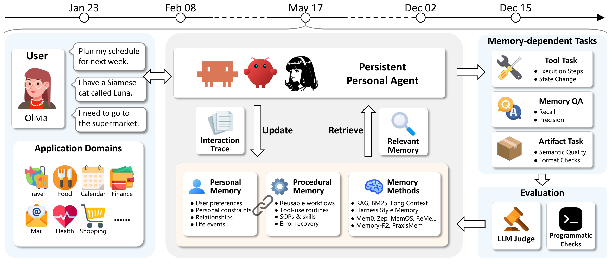
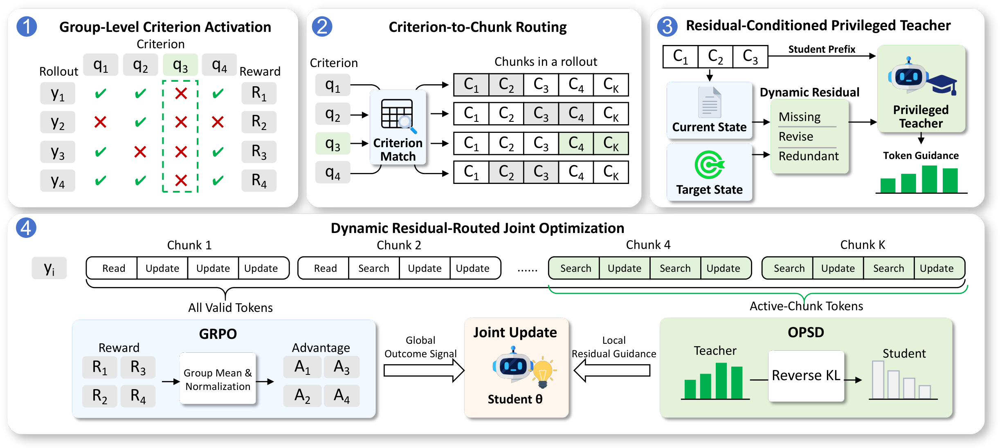

# PraxisMemBench

PraxisMemBench is a harness-based benchmark for persistent personal assistance
across daily-life and work trajectories. It evaluates whether memory methods
effectively manage personal memory, procedural memory, and their evolving
relationships. 

This repository contains the benchmark runtime, memory-method
adapters, and PraxisMem training code.

- [Benchmark setup and evaluation](docs/evaluation/README.md)
- [PraxisMem training](docs/training/README.md)
- [Dataset layout](docs/data/README.md)
- [Harness adapters and supported versions](docs/harnesses/README.md)

## Overview



**PraxisMemBench.** Across sessions, a memory method updates and retrieves
personal and procedural memory from user interactions. Memory and application
state persist across the trajectory and shape later memory-dependent actions.
LLM judges and programmatic checks evaluate Tool, Memory QA, and Artifact tasks.



**PraxisMem.** Criteria missed by every rollout are routed to the chunks where
their memory defects persist. A privileged teacher uses the dynamic residual
between current and target memory states to provide token-level guidance.
Location-aware GRPO trains the full manager rollout, while residual-routed
OPSD supervises the selected chunks.

## Quick Start

Install the Python package and OpenClaw 2026.4.15, then configure the model-service
environment variables listed in the [evaluation guide](docs/evaluation/README.md).

```bash
pip install -e .
pmb download --repository QMMMS/PraxisMemBench
pmb check-data --split test
pmb run --method embedding_rag --name embedding_rag --split test
pmb grade --run outputs/embedding_rag
```

The default settings are in [configs/benchmark.yaml](configs/benchmark.yaml).
Execution saves per-session traces; serial grading produces `report.json` and
`exp_report.html` in the run directory.

To evaluate your own memory method, see [Adding a Memory Method](docs/memory_methods.md)
for the adapter interface, registration steps, and resource reporting.

## Data

Benchmark trajectories and conversation history are available on
[Hugging Face: PraxisMemBench](https://huggingface.co/datasets/QMMMS/PraxisMemBench).
The training samples and canonical memory states are available on
[Hugging Face: PraxisMem-Training](https://huggingface.co/datasets/QMMMS/PraxisMem-Training).
See the [dataset guide](docs/data/README.md) for download and directory details.

## Repository

```text
configs/                       Benchmark and training defaults
assets/                        Benchmark and method overview figures
src/praxismembench/             Runner, applications, harnesses, methods, scoring
src/praxismem/                  Markdown memory manager and training
prompts/                       User-simulation prompt
tools/                         Training-export validation
docs/                          Setup, method and training documentation
data/                          Downloaded datasets
```

The paper appendices **Benchmark Examples** and **Representative Failure Cases**
provide session examples and case studies.

## Citation

```
@misc{qin2026memorizingwhoknowinghow,
      title={Memorizing Who, Knowing How: Benchmarking Personal and Procedural Memory for Persistent Assistants}, 
      author={Maosheng Qin and Qi Zhang and Mingxuan Xia and Jinglei Chen and Jiexiang Wang and Sheng Guo and Cheng Peng and Haobo Wang},
      year={2026},
      eprint={2610.20022},
      archivePrefix={arXiv},
      primaryClass={cs.AI},
      url={https://arxiv.org/abs/2610.20022}, 
}
```
